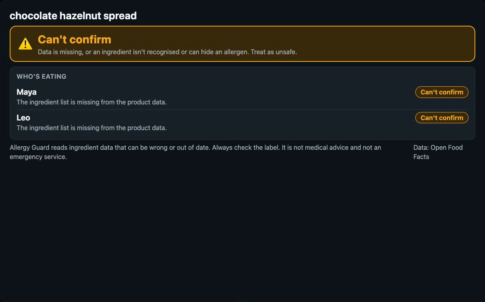
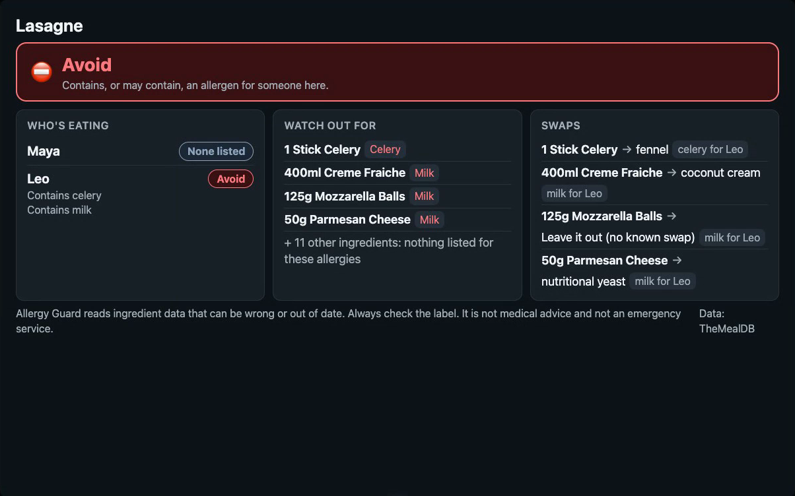
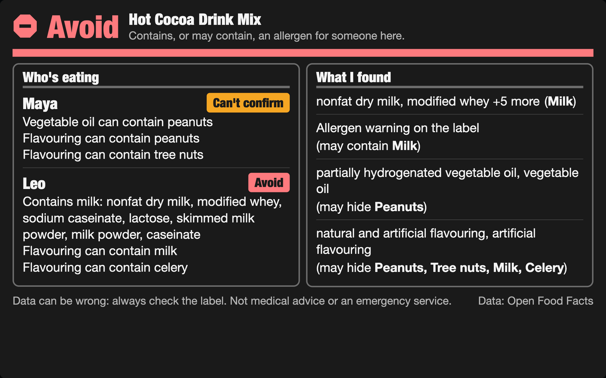
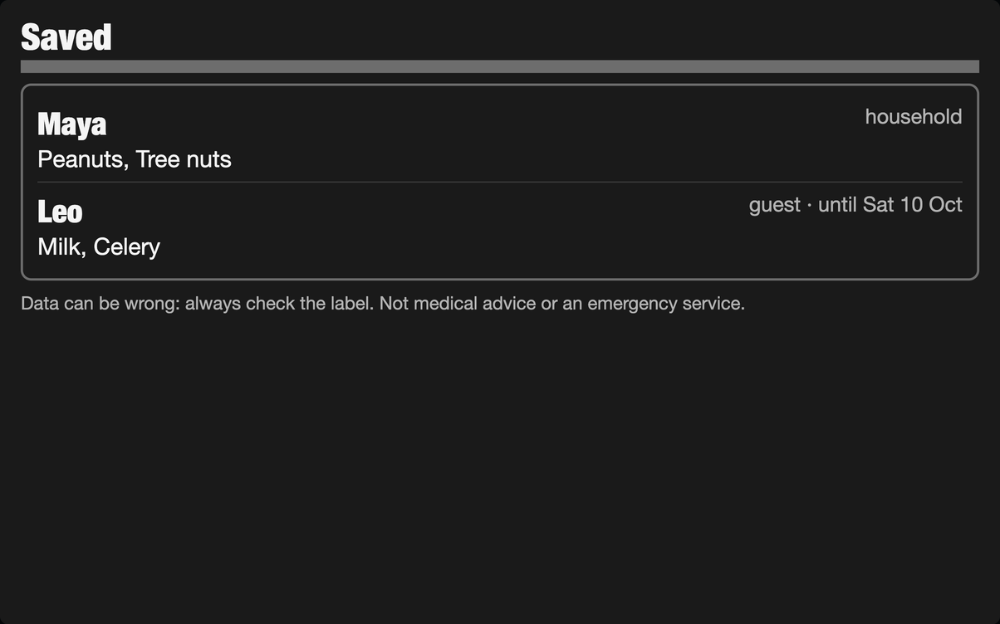

# Allergy Crosscheck for Alexa+

Allergy Crosscheck tells you who at the table can eat a dish or a product, and why. A household tells Alexa who is allergic to what, guests included. It then checks recipes and packaged foods against everyone at the table, explains the risk on an Echo Show screen, suggests swaps that don't trip anyone else's allergy, and puts them on the shopping list.

It is built around one rule: **when the data is missing, ambiguous or the lookup fails, the answer is "I can't confirm it's OK — treat it as unsafe", never a confident yes.** It never tells anyone a food is "safe".

- **Self-hosted MCP server**, MCP spec **2025-11-25**, **Streamable HTTP** (stateless), 9 tools.
- **MCP Apps view** (`ui://allergy-crosscheck/verdict.html`, `text/html;profile=mcp-app`) for Echo Show: verdict banner, per-person results, flagged ingredients, swaps, tap-to-choose products.
- **Phone scan page** (`/scan`): scan a barcode with the camera, then ask "Can Maya have what I just scanned?". Reading out 13 digits works too, but scanning is quicker. It uses the browser's BarcodeDetector, with a WebAssembly fallback for Safari served by the server itself; typed digits work too.
- **Alexa+ simulator**: an LLM drives the server through a real MCP client, with browser voice in and out, and renders the MCP Apps view the way an Echo Show would.
- **Open-source engine** in [`packages/allergen-guard`](packages/allergen-guard): zero dependencies, MIT.

| Missing product data: "can't confirm", never "allergen-free" | A recipe check: verdict per person, the risky lines, swaps checked against everyone |
|---|---|
|  |  |
| **Allergen tags say soy; the ingredient text adds milk** | **A guest saved until Saturday: they drop off after the visit** |
|  |  |

Screens from the recorded demo run: a local model driving the server, with live data.

## Why fail-closed matters here

Open Food Facts, the open food database this uses, says its data comes with "no assurances that the data is accurate, complete, or reliable". Real records prove it. One chocolate hazelnut spread (barcode 0868030000236) has an empty allergen list and no ingredient list, so a checker that trusts the tags would call it allergen-free. A hot cocoa mix (0050700000220) lists soy as its only allergen, with milk only as a "may contain", while its ingredients include nonfat dry milk, whey and sodium caseinate.

Across all 4,784,317 Open Food Facts records (snapshot of 7 October 2026), 72.3% list no allergens, no "may contain" and have no ingredient list, and so do 53.2% of the products scanned in the Open Food Facts app. This engine says "can't confirm" for each. See [`packages/allergen-guard/bench/README.md`](packages/allergen-guard/bench/README.md).

Allergy Crosscheck:

| Situation | Answer |
|---|---|
| A listed allergen, in the tags **or** in the ingredient text | **Avoid** |
| "May contain" | **Avoid** |
| An ingredient that often hides allergens (sauce, stock, chocolate, lecithin…) | **Can't confirm** |
| A recipe word it doesn't recognise ("garam masala", "zorblax") | **Can't confirm**: "I don't know what's in garam masala" |
| A free-from claim ("egg-free mayonnaise") | **Can't confirm**: check the label |
| Ingredient list missing, or not in English | **Can't confirm** |
| Database offline or timing out | **Can't confirm** |
| Product name matches several products | **Asks which one**, never guesses |
| Nobody's allergies saved, or an unknown name in "for" | Says so |
| Nothing found | "I didn't find *X* listed… check the label" |

In the simulator, a **verdict lock** applies: after a check, the spoken answer is the tool's own sentence, so the model can't soften "avoid" into "should be fine". A **no-tool guard** covers the other way a model goes wrong: answering from memory. Without a tool call, the model may ask a question but not assert anything. It gets one nudge to call a tool, and after that its answer is replaced with "I couldn't check that". Both have tests (`test/sim.test.ts`). The full demo conversation was run end to end on a local Qwen3.5 9B (4-bit, MLX).

## Run it

Node 22.6 or newer. No build step.

```bash
npm install
npm start                     # MCP: http://127.0.0.1:8787/mcp   Simulator: http://127.0.0.1:8787/
```

Open the simulator and use the **demo script** buttons. They need no LLM. Each button is one MCP tool call, and they reproduce the video's checks: the spread with no ingredient list ("Can't confirm") and the cocoa mix whose tags miss the milk ("Avoid" for Leo).

To talk to it, point it at any OpenAI-compatible endpoint with tool calling:

```bash
LLM_BASE_URL=https://api.openai.com/v1 LLM_MODEL=gpt-4.1-mini LLM_API_KEY=... npm start
# or a local model: LLM_BASE_URL=http://127.0.0.1:8080/v1 LLM_MODEL=mlx-community/Qwen3.5-9B-4bit npm start
```

| Variable | Default | |
|---|---|---|
| `PORT` / `HOST` | `8787` / `127.0.0.1` | |
| `DATA_FILE` | `data/household.json` | The household's profiles and shopping list |
| `ALLOWED_HOSTS` | — | Extra Host headers to accept, e.g. a tunnel hostname (DNS-rebinding guard) |
| `LLM_BASE_URL`, `LLM_MODEL`, `LLM_API_KEY` | — | Simulator voice mode |

### Connect a real MCP client

Any client that speaks Streamable HTTP works, for example the MCP Inspector:

```bash
npx @modelcontextprotocol/inspector   # transport: Streamable HTTP, URL: http://127.0.0.1:8787/mcp
```

### Alexa+

The Alexa+ MCP Toolkit currently serves US accounts. To connect this server to Alexa+:

1. Run Amazon's Local Inspector against it (installed from the Developer Console): `addon-local-inspector http://127.0.0.1:8787/mcp`. It writes a certification verdict to `/tmp/alexaplus-addon-local-inspector-live/`.
2. Expose it over HTTPS, e.g. `cloudflared tunnel --url http://127.0.0.1:8787`, and add the tunnel host to `ALLOWED_HOSTS`.
3. Scaffold an add-on with `alexa-ai new mcp` pointing at `https://<host>/mcp`, then `alexa-ai deploy`.
4. Test in the Alexa+ web simulator.

The simulator in this repo stands in for steps 3 and 4.

The same HTTPS host serves the phone scan page at `https://<host>/scan`; browsers only open the camera on https pages (or localhost).

The screen follows the Alexa+ MCP design guide:
- every demo screen fits one Echo Show 8 screen (measured at 944×590 in headless Chrome): long product lists are grouped by allergen, with "+N more";
- 16px minimum text, 48px touch targets, and 4.5:1 contrast in both themes;
- it applies the host's theme, device class and safe-area insets;
- no links out of the view.

Each tool declares `_meta.ui.resourceUri` with `invoking`/`invoked` status lines, and every result repeats `resourceUri`. Not-found results set `isError`.

### What Alexa+ receives

Captured from a live server with the MCP SDK client (`check_product` on the cocoa mix, Maya and Leo saved). The negotiated protocol version is `2025-11-25`; there are 9 tools.

The tool definition's `_meta`:

```json
{ "ui": { "resourceUri": "ui://allergy-crosscheck/verdict.html", "invoking": "Checking the product…", "invoked": "Product checked" },
  "ui/resourceUri": "ui://allergy-crosscheck/verdict.html" }
```

The tool result, trimmed (`structuredContent` also carries each person's reasons and the grouped ingredient rows for the screen):

```json
{
  "content": [{ "type": "text", "text": "VERDICT: UNSAFE\nSay to the user: Leo should avoid this: it contains milk, in the whey, caseinate and lactose. I can't confirm this is OK for Maya: vegetable oil and flavouring can contain peanuts and tree nuts. Treat it as unsafe and check the label." }],
  "structuredContent": { "kind": "product_check", "title": "Hot Cocoa Drink Mix", "overall": "unsafe",
    "people": [{ "name": "Maya", "verdict": "cannot_confirm" }, { "name": "Leo", "verdict": "unsafe" }], "…": "…" },
  "_meta": { "ui": { "resourceUri": "ui://allergy-crosscheck/verdict.html" }, "ui/resourceUri": "ui://allergy-crosscheck/verdict.html" },
  "isError": false
}
```

## Tools

| Tool | What it does |
|---|---|
| `save_person` | Save a household member or guest (with an optional last day) and their allergies; unknown allergies are rejected, not dropped |
| `remove_person`, `list_people` | Manage who is checked |
| `check_recipe` | Ingredients, or a dish name looked up on TheMealDB; verdict per person, flagged lines, household-aware swaps |
| `check_product` | The product just scanned on the phone, or by barcode or name (Open Food Facts); several matches → choices; no recent scan → asks for one |
| `find_recipe` | Look up a dish's ingredient list |
| `add_to_shopping_list`, `get_shopping_list`, `remove_from_shopping_list` | Shopping list for the swaps |

Every tool result has a short `speech` line for voice, a `VERDICT:` line for the model, and `structuredContent` for the screen.

## Tests

```bash
npm test          # 69 tests: engine, store, MCP over Streamable HTTP, phone scan, simulator verdict lock, no-tool guard, history trimming
npm run typecheck
```

The engine suite has 54 ingredient–allergen pairs that must never come back as "nothing listed", among them peanut butter, pesto, ghee, soy sauce, Worcestershire sauce, lupin flour and amaretto. It also has look-alikes that must not be flagged: butter beans, coconut milk, nutmeg, oyster mushrooms, eggplant. Swaps are tested too: never a plant relative of what they replace (no fennel for celery, no horseradish for mustard), and never anything that trips someone else in the household. The MCP suite runs over real HTTP with the SDK client and confirms the negotiated protocol version is `2025-11-25`.

## Layout

```
packages/allergen-guard/   open-source engine: catalogue, fail-closed checks, swaps (MIT)
src/server/                MCP server: tools, MCP Apps resource, HTTP, household store, data sources
src/sim/agent.ts           simulated Alexa+ turn (LLM + MCP client + verdict lock)
public/widget.html         MCP Apps view (the Echo Show screen)
public/simulator.html      Echo Show-style simulator and MCP Apps host
public/scan.html           phone scan page (camera barcode → "what I just scanned")
test/                      integration tests
```

## What was tested, and where

| | |
|---|---|
| Engine, store, MCP over real HTTP, phone scan, simulator guards | 69 automated tests (`npm test`) |
| The scan page | Headless Chrome with a fake camera showing a barcode image: decoded, looked up and checked through the real model ("what I just scanned") |
| The full demo conversation | End to end in the simulator on a local model (Qwen3.5 9B, 4-bit, MLX), against live Open Food Facts and TheMealDB data |
| The Echo Show screen and the tap-to-choose flow | Headless Chrome, at the simulator's Echo Show size, in dark and light themes; every demo button's screen measured to fit at 944×590 |
| Real Alexa+ | **Not tested.** The Alexa+ MCP Toolkit serves US accounts, and this was built outside the US |
| Amazon's Local Inspector | **Not run.** It installs from a private registry that needs an AWS account with access to an Amazon role (friction log 4) |

The verdict lock and the no-tool guard live in the simulator (`src/sim/agent.ts`). On real Alexa+, add-ons can't script what Alexa says. There, the defence is in the server: every result leads with a `VERDICT:` line and the exact sentence to say, and the tool descriptions tell the model to repeat it. Asking Amazon for a verbatim-speech hook is entry 2 in the [friction log](docs/FRICTION_LOG.md).

## Limits, stated plainly

- English ingredient text only. Products without it get "can't confirm".
- In a recipe, a word the dictionary doesn't know gives "can't confirm", never "none listed". Across all 790 TheMealDB recipes, 2.6% of ingredient lines hit that rule; the rest are recognised. The remaining risk is a known word that hides an allergen under a name the dictionary treats as plain. That's why every answer ends with "check the label".
- Product checks read the label's declared allergens, traces and English ingredient text; unrecognised words there don't block an answer, because the declaration is the legal record.
- Saying someone is "also allergic to" something adds it; only "no longer allergic" replaces the list.
- It isn't medical advice and isn't an emergency service.
- Data: Open Food Facts (ODbL). Product data: [Open Food Facts](https://world.openfoodfacts.org), ODbL. Recipes: [TheMealDB](https://www.themealdb.com), using its free development key.
